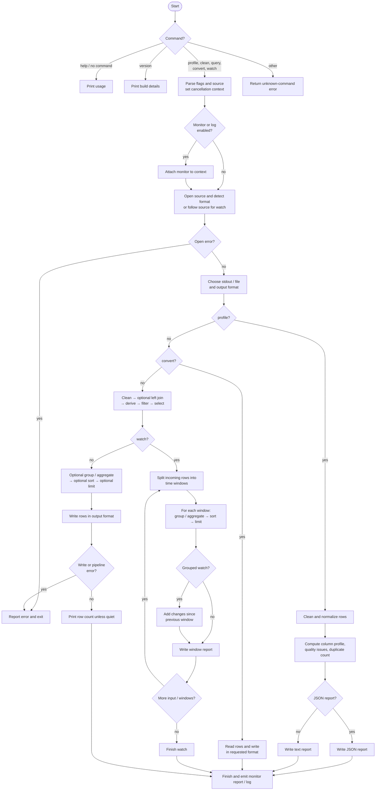

# Datacom architecture

Datacom is a Go command-line data tool. Its CLI coordinates file/network I/O and
selects a command; the `pipeline` package reads, transforms, and writes tables.
Rows normally flow through bounded channels, with one goroutine per stage.

## System architecture

```mermaid
flowchart LR
    User["CLI user / shell"] --> CLI["main.go<br/>command, flags, context"]

    subgraph Sources["Input sources"]
        File["Local file"]
        Stdin["stdin"]
        URL["HTTP(S) URL"]
        Follow["Growing file / stdin<br/>watch mode"]
    end
    CLI --> Open["open / pipeline.Open"]
    File --> Open
    Stdin --> Open
    URL --> Remote["remote reader<br/>retry, resume, backoff"]
    Remote --> Open
    CLI --> Follow

    Open --> Detect["format detection<br/>and gzip decoding"]
    Detect --> Decode["pipeline.Read"]
    Follow --> Decode
    Decode --> Decoders["CSV / TSV<br/>JSON / NDJSON<br/>XLSX / Parquet"]
    Decoders --> Raw["Table: header + row channel"]

    subgraph Processing["CLI-selected processing stages"]
        Clean["Clean<br/>headers, types, empty rows, dedupe"]
        Join["Left join<br/>right-side lookup held in memory"]
        Derive["Derive columns"]
        Filter["Where filters"]
        Select["Select / rename columns"]
        Aggregate["Group and aggregate<br/>memory per group"]
        Sort["Sort<br/>buffers rows"]
        Limit["Limit"]
    end
    Raw --> Clean --> Join --> Derive --> Filter --> Select
    Select --> Aggregate --> Sort --> Limit
    Select -. optional stages skipped .-> Limit

    Profile["profile: compute dataset summary"]
    Windows["watch: split into time windows"]
    WatchReport["Per-window group / aggregate<br/>→ sort → limit<br/>→ optional Trend"]
    Convert["convert: read → write"]
    Clean --> Profile
    Select --> Windows --> WatchReport
    Raw --> Convert

    Limit --> Write["pipeline.Write"]
    WatchReport --> Write
    Convert --> Write
    Write --> Dest["stdout or output file<br/>table / CSV / TSV / JSON / NDJSON /<br/>Markdown / XLSX / Parquet"]
    Profile --> ProfileOut["text or JSON report"]
    ProfileOut --> ProfileDest["stdout or output file"]

    subgraph Observability["Optional monitoring"]
        Monitor["Monitor<br/>bytes, rows, data-quality findings,<br/>buffer notes, errors"]
        Log["stderr progress / final report<br/>optional JSONL log"]
    end
    CLI -. attaches to context .-> Monitor
    Decode -. counts input .-> Monitor
    Clean -. reports data-quality findings .-> Monitor
    Join -. reports unmatched keys .-> Monitor
    Aggregate -. reports large group counts .-> Monitor
    Sort -. reports large buffers .-> Monitor
    Write -. records output and error .-> Monitor
    Monitor --> Log

    CLI -. cancellation / first error .-> Raw
    Raw -. shared context and error .-> Clean
    Clean -. shared context and error .-> Join
    Join -. shared context and error .-> Derive
    Derive -. shared context and error .-> Filter
    Filter -. shared context and error .-> Select
    Select -. shared context and error .-> Aggregate
    Aggregate -. shared context and error .-> Sort
    Sort -. shared context and error .-> Limit
```

Each pipeline stage passes rows over a bounded channel (512 rows) and shares
the run's cancellation and first error. This bounds per-row memory for
streaming stages; deduplication retains row hashes, joins retain the right
input, grouping retains group state, and sorting buffers its input. XLSX and
Parquet require random access; non-file inputs are spooled where needed.

## Command flow

For `clean` and `query`, the report stages are only added when requested.
`convert` bypasses cleaning and shaping; `profile` computes a dataset summary;
`watch` follows its source and emits reports repeatedly until input ends or
the run is cancelled.
