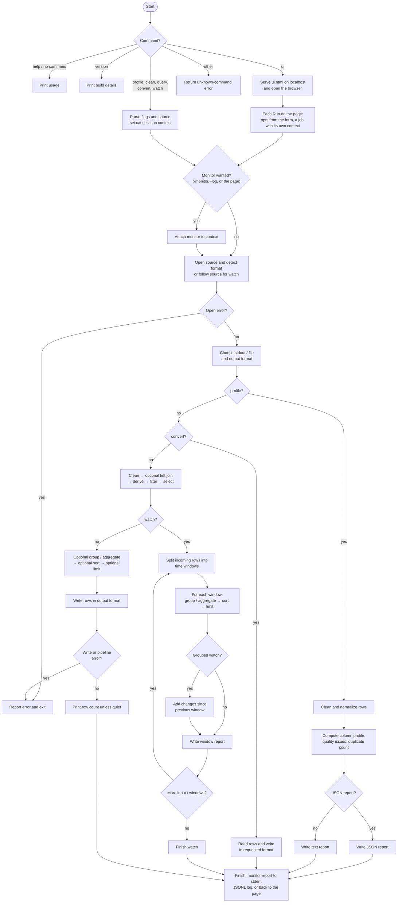

# Datacom architecture

Datacom is a Go data tool with two front ends and one engine. The command line
in `main.go` and the browser page served by `datacom ui` both build the same
options struct and call the same `run` function; the `pipeline` package reads,
transforms and writes tables. Rows flow through bounded channels, one goroutine
per stage.

## System architecture

```mermaid
flowchart LR
    User["Terminal user"] --> CLI["main.go<br/>flags → opts"]
    Browser["Browser user"] --> Page["ui.html<br/>served by datacom ui"]
    Page --> API["ui.go<br/>local HTTP server, token-guarded:<br/>upload, columns, jobs, download"]
    CLI --> Run["run(ctx, command, opts)"]
    API --> Run

    subgraph Sources["Input sources"]
        File["Local file or upload copy"]
        Stdin["stdin"]
        URL["HTTP(S) URL"]
        Follow["Growing file / stdin<br/>watch mode"]
    end
    Run --> Open["open / pipeline.Open"]
    File --> Open
    Stdin --> Open
    URL --> Remote["remote reader<br/>retry, resume, backoff"]
    Remote --> Open
    Run --> Follow

    Open --> Detect["format detection<br/>and gzip decoding"]
    Detect --> Decode["pipeline.Read"]
    Follow --> Decode
    Decode --> Decoders["CSV / TSV<br/>JSON / NDJSON<br/>XLSX / Parquet"]
    Decoders --> Raw["Table: header + row channel"]

    subgraph Processing["Processing stages, added as requested"]
        Clean["Clean<br/>headers, types, -text documents,<br/>empty rows, dedupe"]
        Join["Left join<br/>right side held in memory"]
        Derive["Derive columns"]
        Filter["Where filters"]
        Quality["Quality rules<br/>parallel"]
        Decontam["Test-set overlap<br/>parallel"]
        Near["Near-duplicates<br/>fixed-size MinHash index"]
        Select["Select / rename columns"]
        Redact["Mask personal data<br/>parallel"]
        Aggregate["Group and aggregate<br/>memory per group"]
        Sort["Sort<br/>buffers rows"]
        Limit["Limit"]
    end
    Raw --> Clean --> Join --> Derive --> Filter --> Quality --> Decontam --> Near --> Select --> Redact
    Redact --> Aggregate --> Sort --> Limit
    Redact -. stages not requested are skipped .-> Limit

    Profile["profile: dataset summary"]
    Windows["watch: split into time windows"]
    WatchReport["Per window: group / aggregate<br/>→ sort → limit → Trend"]
    Convert["convert: read → write"]
    Clean --> Profile
    Select --> Windows --> WatchReport
    Raw --> Convert

    Limit --> Write["pipeline.Write"]
    WatchReport --> Write
    Convert --> Write
    Write --> Dest["stdout, output file, or a job file<br/>table / CSV / TSV / JSON / NDJSON /<br/>Markdown / XLSX / Parquet"]
    Profile --> ProfileOut["text or JSON report"]
    ProfileOut --> Dest
    Dest -. preview and download .-> API

    subgraph Observability["Monitoring"]
        Monitor["Monitor<br/>bytes, rows, untyped values,<br/>buffer notes, errors"]
        Log["stderr progress and report<br/>optional JSONL log"]
    end
    Run -. attaches to context .-> Monitor
    Decode -. counts input .-> Monitor
    Clean -. untyped values, padded and dropped rows .-> Monitor
    Join -. unmatched keys .-> Monitor
    Aggregate -. large group counts .-> Monitor
    Sort -. large buffers .-> Monitor
    Write -. rows out, error .-> Monitor
    Monitor --> Log
    Monitor -. polled for progress, final report .-> API

    Run -. cancellation / first error .-> Raw
    Raw -. shared context and error .-> Clean
    Clean -. shared context and error .-> Join
    Join -. shared context and error .-> Derive
    Derive -. shared context and error .-> Filter
    Filter -. shared context and error .-> Select
    Select -. shared context and error .-> Aggregate
    Aggregate -. shared context and error .-> Sort
    Sort -. shared context and error .-> Limit
```

Each stage passes rows over a channel of 512 and shares the run's cancellation
and first error, so memory per row stays flat however many stages are chained.
Dedupe keeps one 8-byte hash per distinct row, join keeps the right-hand table,
grouping keeps one accumulator per group, and sort keeps every row. XLSX and
Parquet need random access, so a piped or uploaded input is spooled to a
temporary file first.

## Command flow

For `clean` and `query`, the report stages are only added when requested.
`convert` bypasses cleaning and shaping; `profile` computes a dataset summary;
`watch` follows its source and emits reports until input ends or the run is
cancelled.

## Browser interface

`datacom ui` binds a plain `net/http` server to 127.0.0.1 and serves one
embedded page. The page never talks to anything else, and every API call
carries a token minted at startup, so another tab cannot drive the server.

- **Source.** A dropped or chosen file is streamed into a temporary folder,
  keeping its name so format detection still works; a typed path or URL is
  used as is. The page then asks for the header, cleaned the way the chosen
  options would clean it, so filters, totals and sorting are built from the
  file's real column names and translated into the same flags and expressions
  the command line takes.
- **Jobs.** Run posts the form as one request. The server builds an `opts`,
  points its output at a file in the temporary folder, and calls `run` in a
  goroutine under a cancellable context. The page polls the job: while it
  runs, rows and bytes come from the attached Monitor (and the tail of the
  output file for `watch`); when it finishes, the Monitor's report, a preview
  and a download link come back. Stop cancels the context, which unwinds every
  stage exactly as Ctrl-C does.
- **Preview.** The output is read back through `pipeline.Read`, so an Excel or
  Parquet result previews as faithfully as CSV. Profile and watch results are
  text and are shown as written.
- **Cleanup.** Ctrl-C in the terminal cancels every job, waits for their files
  to close, and removes the temporary folder.

## Many sources, parts and the run record

- **Sources.** Globs over local folders, `s3://`, `gs://` and `hf://` are
  expanded by listing before the run starts. Cloud objects are read through
  the same resumable HTTP reader as URLs, with each request signed (SigV4
  for S3, a bearer token for GCS and the Hub).
- **One output.** Several sources are read in order as one table by
  `Concat`, which opens each under its own context so a `-limit` or an
  error stops the source being read.
- **Parts.** With `-o out/`, every source runs its own pipeline into its own
  part, `-workers` at a time. The parts share one exact-duplicate set, one
  near-duplicate index and one loaded test set, so deduplication is global.
  Each part's parallel stages get a share of the cores rather than all of
  them.
- **Parallel stages.** Quality, test-set overlap, near-duplicate signatures
  and masking run their costly work in batches of 64 rows on every core and
  hand results on in input order, so output matches a single-threaded run.
  A partial batch is flushed after 20 ms so live inputs are not held back.
- **Run record.** With `-manifest`, a ledger in the context records each
  source as it is opened: local files are hashed whole by a goroutine of
  their own, streams as they are read. Outputs are hashed through the writer
  after compression. When the run ends, the ledger, the monitor's per-rule
  counters and the options become the manifest.
